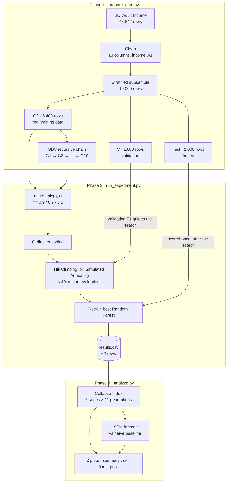
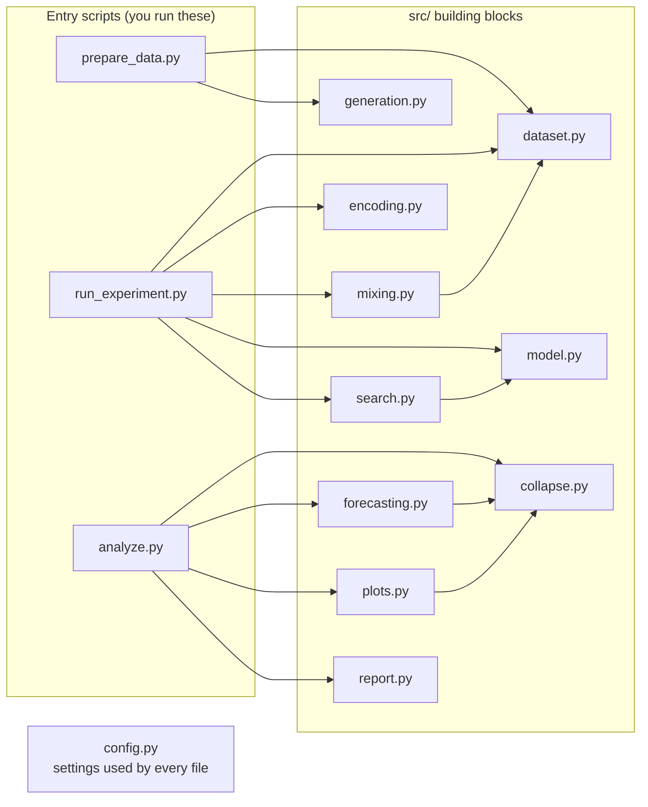
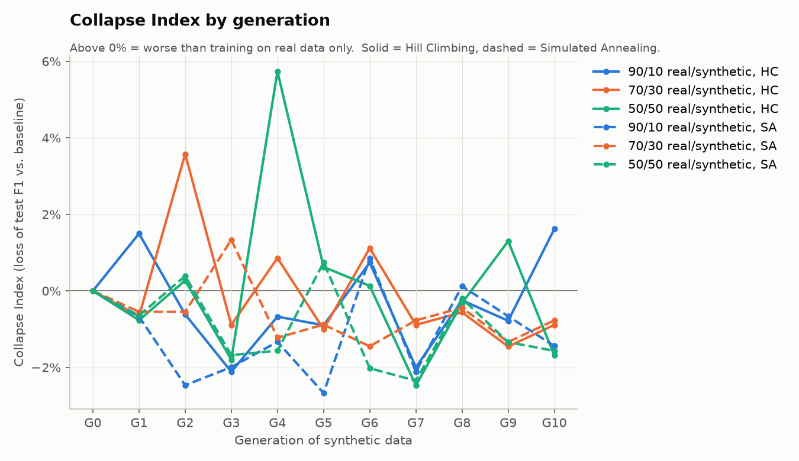
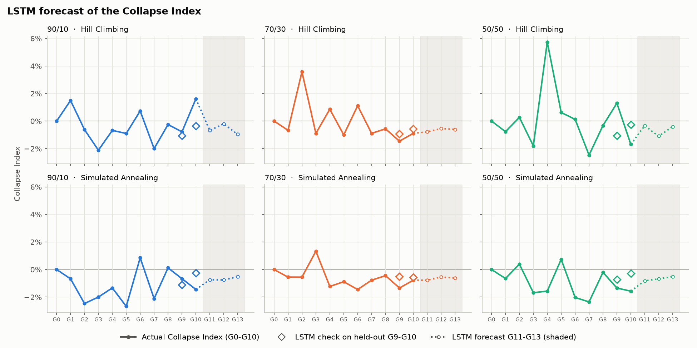

# BlackMirror

### Does a model trained on AI-generated data slowly lose touch with reality?

BlackMirror studies **recursive synthetic data**: a model learns from real data, generates fake data, the next model learns from *that* fake data, and so on for 10 generations. At each generation we train a Random Forest on a mix of real and synthetic rows, tune it with two AI search algorithms, and check how well it still predicts **real** people.

> **Research question:** How do the synthetic-data ratio and the optimization algorithm affect predictive performance and degradation across generations?

**Repository:** https://github.com/Ramprasath-0103/blackmirror

---

## Table of contents

1. [Project idea](#1-project-idea)
2. [Tech stack](#2-tech-stack)
3. [Implementation](#3-implementation)
4. [Architecture and workflow](#4-architecture-and-workflow)
5. [Getting started](#5-getting-started)
6. [Results](#6-results)
7. [Output files](#7-output-files)
8. [Configuration](#8-configuration)
9. [Reproducibility and built-in checks](#9-reproducibility-and-built-in-checks)
10. [Important design decisions](#10-important-design-decisions)
11. [Troubleshooting](#11-troubleshooting)
12. [Glossary](#12-glossary)
13. [Team and contributing](#13-team-and-contributing)
14. [Acknowledgements](#14-acknowledgements)

---

## 1. Project idea

### The problem

Imagine photocopying a photocopy. The first copy looks fine, but each new copy loses a little detail, and after enough rounds the picture is blurry. Researchers worry that machine-learning models could go the same way as more of the data they learn from is produced by other models. This effect is often called **model collapse**.

### What we do

We recreate the "photocopy of a photocopy" process with a table of real census data:

```
real data (G0) ──► synthetic G1 ──► synthetic G2 ──► … ──► synthetic G10
                   learned from G0  learned from G1 only   learned from G9 only
```

At every generation we:

1. **Mix** real and synthetic rows in three ratios: **90/10**, **70/30** and **50/50** (real/synthetic).
2. **Tune** a Random Forest on the mix with **Hill Climbing** and with **Simulated Annealing**.
3. **Test** the tuned model once on real people it has never seen.
4. **Measure** the loss against a model trained on 100% real data. This is the **Collapse Index**.
5. **Forecast** the Collapse Index for future generations with an **LSTM** neural network.

### What we compare

| Factor (what we change) | Levels |
|---|---|
| Synthetic-data ratio | 90/10, 70/30, 50/50 |
| Optimization algorithm | Hill Climbing, Simulated Annealing |
| Generation | G1 to G10, plus the G0 baseline |

| Outcome (what we measure) | How |
|---|---|
| Predictive performance | Accuracy, precision, recall and F1 on a frozen real test set |
| Degradation | Collapse Index: relative F1 loss against the baseline |
| Future degradation | LSTM forecast of G11–G13, checked against a naive baseline |

### Key finding (short version)

In this setup, 10 generations of synthetic data did **not** cause a clear collapse. The Collapse Index stays between −2.7% and +5.7% and moves up and down rather than rising. Simulated Annealing matched or beat Hill Climbing in 27 of 30 runs. The details are in [Results](#6-results).

---

## 2. Tech stack

| Tool | Version | What it's used for | Where in the code |
|---|---|---|---|
| **Python** | 3.12 | The language for everything | — |
| **pandas** | 2.3.3 | Reading, cleaning, mixing and saving tables (CSV files) | everywhere |
| **ucimlrepo** | 0.0.7 | Downloading the official Adult Income dataset from UCI | `src/dataset.py` |
| **scikit-learn** | 1.9.1 | Stratified splits, `OrdinalEncoder`, `RandomForestClassifier`, F1 and other metrics | `src/dataset.py`, `src/encoding.py`, `src/model.py` |
| **SDV** (Synthetic Data Vault) | 1.38.5 | `GaussianCopulaSynthesizer`, which creates the synthetic generations | `src/generation.py` |
| **TensorFlow / Keras** | 2.21.0 / 3.15 | The LSTM that forecasts the Collapse Index | `src/forecasting.py` |
| **NumPy** | 2.x (installed with the above) | Arrays and the random number generator used by Simulated Annealing | `src/search.py`, `src/forecasting.py` |
| **matplotlib** | 3.11.2 | The two result plots | `src/plots.py` |

All versions are pinned in [`requirements.txt`](requirements.txt), so every team member gets the same numbers.

**Dataset:** [Adult Income](https://archive.ics.uci.edu/dataset/2/adult) from the UCI Machine Learning Repository. It contains 48,842 people from the 1994 US census, and the task is to predict whether a person earns more than $50K a year.

---

## 3. Implementation

The project runs in **three phases**. Each phase is one script, and each script writes files that the next phase reads.

### Phase 1: Data and generation (`prepare_data.py`)

| Step | What happens | Why |
|---|---|---|
| **1. Load** | `fetch_ucirepo(id=2)`, then features and target are joined into one table | Uses the official UCI copy, so there's no manual downloading |
| **2. Clean** | Drop `fnlwgt` and `education`. Turn `NaN` and `"?"` into `"Unknown"`. Fix the label (`">50K."` becomes `">50K"`) and map it to **1 = >50K, 0 = <=50K** | `fnlwgt` describes how a person was sampled, not the person. `education` duplicates `education-num`. No rows are lost. The raw label has 4 spellings |
| **3. Split** | Stratified sample of 10,000 rows, split into **Test 2,000**, **V 1,600** and **G0 6,400** | Every set keeps the same share of >50K people (about 24%) |
| **4. Metadata** | Tell SDV the type of every column explicitly | Otherwise SDV might treat `income` (0/1) as a number and generate values like 0.37 |
| **5. Recursive chain** | For g = 1…10, a **fresh** `GaussianCopulaSynthesizer` is fitted on generation g−1 and samples 6,400 rows | Each generation sees only the previous one, so errors pile up |
| **6. Checks** | Columns, missing values, labels, row counts, >50K rate and file fingerprints | Catches problems before Phase 2 uses the data |

After cleaning there are **13 columns**: 12 features plus `income`.

| Set | Rows | Used for | Never used for |
|---|---|---|---|
| **G0** | 6,400 | Seeding SDV, the real part of every mix, the baseline | Scoring |
| **V** (validation) | 1,600 | Scoring hyperparameters during the search | Training, generation |
| **Test** | 2,000 | The final score, once per run | Training, generation, search |

**Mixing.** `make_mix(g, r)` builds a 6,400-row training set from `r × 6,400` real rows from G0 and the rest from generation `g`, then shuffles it. For a given ratio the **same real rows** are used at every generation, so the only thing that changes is where the synthetic rows come from.

### Phase 2: Optimization and evaluation (`run_experiment.py`)

**Encoding.** A Random Forest needs numbers, so an `OrdinalEncoder` turns each category into an integer code (for example "Private" becomes 3). It is fitted **once** on G0 and reused for every run. A category it has never seen gets the code −1 instead of crashing the program.

**Search space.** There are 6 × 6 × 5 = **180** possible Random Forest configurations:

| Hyperparameter | Options |
|---|---|
| `n_estimators` (number of trees) | 50, 100, 150, 200, 250, 300 |
| `max_depth` (maximum tree depth) | 2, 4, 6, 8, 10, None (no limit) |
| `min_samples_split` (rows needed to split a node) | 2, 4, 6, 8, 10 |

**Search as an AI problem:**

| Concept | Definition |
|---|---|
| State | Three indices into the grid, e.g. `(1, 1, 0)` |
| Initial state | `(1, 1, 0)`, meaning 100 trees, depth 4, split 2 |
| Action | Move one hyperparameter one step up or down |
| Transition | Gives a neighbouring state (at most 6 neighbours) |
| Evaluation | F1 on the validation set V |
| Goal | The highest F1 |
| Termination | 40 unique evaluations, or no better neighbour (Hill Climbing) |

**The objective** trains a forest with the state's settings on the mix and returns its F1 on V. It keeps a **cache** of every score, so a repeated state is free and only **unique** evaluations count towards the budget of 40.

**Hill Climbing** (steepest ascent):

```
current = START
loop:
    score every neighbour of current
    if the best neighbour is better than current: move there
    else: stop                                   ← local optimum
```

**Simulated Annealing:**

```
current = best = START,  T = 0.05
while budget is left:
    pick a random neighbour
    if it is better: move there
    else: move there anyway with probability exp(Δ / T)   ← allows escaping local optima
    remember the best state ever seen
    T = T × 0.9                                           ← cool down: explore early, climb later
```

Both algorithms use the same start, neighbours, budget and objective. Only the rule for accepting a move differs, so any difference in results comes from the algorithm.

**Final evaluation.** The best settings are used to retrain the forest, which then predicts the **Test** set **once**. Accuracy, precision, recall and F1 are appended as one row to `results/results.csv`.

**The grid of runs:**

```
1 baseline (G0, 100% real)  +  10 generations × 3 ratios   =  31 training mixes
31 mixes × 2 algorithms                                    =  62 runs
```

### Phase 3: Degradation and forecasting (`analyze.py`)

**Collapse Index.** There are 6 series (3 ratios × 2 algorithms), each with 11 points (G0 to G10):

```
CI_g = (F1_base − F1_g) / F1_base        F1_base = baseline test F1 of the SAME algorithm
```

| Value | Meaning |
|---|---|
| CI = 0.10 | 10% worse than training on real data only |
| CI = 0 | No change |
| CI < 0 | Slightly better than the baseline. This is a legitimate result, so the sign is kept |

**LSTM forecast:**

| Item | Setting |
|---|---|
| Model | Keras `LSTM(16)` → `Dense(1)`, MSE loss, Adam, 500 epochs, batch size 8 |
| Input | 3 consecutive CI values, used to predict the next value |
| Training data | Windows from all 6 series, **G0 to G8 only** (36 windows) |
| Honest check | Predict the held-out **G9 and G10** and measure the error (MAE) |
| Naive baseline | "Next value = last value". The LSTM must beat this to be useful |
| Forecast | G11 to G13, feeding each prediction back in as input |

**Outputs:** two plots, a summary table and a plain-English `findings.txt` that answers the research question.

---

## 4. Architecture and workflow

### 4.1 End-to-end workflow



### 4.2 Code architecture

The three **entry scripts** in the main folder are short recipes. All the logic lives in small, single-purpose modules in **`src/`**, and every file reads its settings from **`config.py`**.



### 4.3 Project structure

```
blackmirror/
│
├── README.md              ← you are here
├── requirements.txt       ← libraries to install (exact versions)
├── config.py              ← ALL settings: seeds, sizes, column names, search grid, file paths
│
├── prepare_data.py        ← PHASE 1  run first
├── run_experiment.py      ← PHASE 2  run second
├── analyze.py             ← PHASE 3  run third
│
├── src/                   ← building blocks used by the three scripts
│   ├── dataset.py         ← load, clean and split the real data; read saved files
│   ├── generation.py      ← SDV metadata and the recursive synthetic chain
│   ├── mixing.py          ← make_mix(): real + synthetic rows at a given ratio
│   ├── encoding.py        ← text categories → numbers
│   ├── model.py           ← train a Random Forest; F1, precision, recall, accuracy
│   ├── search.py          ← search space, objective, Hill Climbing, Simulated Annealing
│   ├── collapse.py        ← the Collapse Index
│   ├── forecasting.py     ← the LSTM forecast and the naive baseline
│   ├── plots.py           ← the two figures
│   └── report.py          ← summary table and written findings
│
├── data/                  ← created by Phase 1 (G0–G10, val, test, metadata.json); not stored in git
└── results/               ← created by Phases 2 and 3 (CSVs, findings.txt, plots/)
```

### 4.4 How the phases hand over data

The phases only talk to each other through files. This makes each phase easy to run, check and rerun on its own.

| File | Written by | Read by |
|---|---|---|
| `data/G0.csv` | Phase 1 | Phase 2: fitting the encoder, the real part of every mix |
| `data/G1.csv` … `data/G10.csv` | Phase 1 | Phase 2: the synthetic part of every mix |
| `data/val.csv` | Phase 1 | Phase 2: the search objective |
| `data/test.csv` | Phase 1 | Phase 2: the final evaluation only |
| `results/results.csv` | Phase 2 | Phase 3 |
| `results/collapse_index.csv`, `lstm_forecast.csv`, `summary.csv`, `findings.txt`, `plots/` | Phase 3 | You |

### 4.5 Where each part of the plan lives

| Plan section | File | Main function(s) |
|---|---|---|
| Shared constants | `config.py` | — |
| 1.1 Load / 1.2 Clean / 1.3 Split | `src/dataset.py` | `load_adult()`, `clean_adult()`, `split_dataset()` |
| 1.4 SDV metadata / 1.5 Recursive chain | `src/generation.py` | `build_metadata()`, `generate_chain()` |
| 1.6 Mixer | `src/mixing.py` | `make_mix()` |
| 2.1 Encoding | `src/encoding.py` | `fit_encoder()`, `to_xy()` |
| 2.2 Search space and objective | `src/search.py` | `neighbors()`, `Objective` |
| 2.3 Hill Climbing / 2.4 Simulated Annealing | `src/search.py` | `hill_climbing()`, `simulated_annealing()` |
| 2.5 Final evaluation | `run_experiment.py`, `src/model.py` | `run_one()`, `test_metrics()` |
| 2.6 Run the grid | `run_experiment.py` | `main()` |
| 3.1 Collapse Index | `src/collapse.py` | `collapse_index_table()` |
| 3.2 LSTM forecasting | `src/forecasting.py` | `train_lstm()`, `forecast_table()`, `holdout_mae()` |
| 3.3 Plots, table, interpretation | `src/plots.py`, `src/report.py` | `plot_*()`, `build_summary()`, `write_findings()` |

### 4.6 How to read the code

1. **Start with `config.py`** to see every setting in one place.
2. **Read the three entry scripts in order.** Each one prints and runs numbered steps (Step 1/6, Step 2/6 …).
3. **Open the `src/` module behind any step you want to understand.** Every module starts with a short description of what's inside and why.

---

## 5. Getting started

### Prerequisites

| You need | Notes |
|---|---|
| **Python 3.12** | TensorFlow does not support every Python version yet (3.14, for example). Check with `python3 --version` |
| **Git** | To clone the repository |
| **Internet access** | Only for installing the libraries and for the first data download |
| **About 2 GB of free disk space** | Mostly TensorFlow, plus PyTorch, which SDV installs automatically |

### Step 1: Clone the repository

```bash
git clone https://github.com/Ramprasath-0103/blackmirror.git
```

```bash
cd blackmirror
```

### Step 2: Create a virtual environment

A virtual environment is a private folder for this project's libraries, so they don't clash with anything else on your computer. On Windows, use `py -3.12 -m venv .venv` instead.

```bash
python3.12 -m venv .venv
```

### Step 3: Activate it

Do this every time you open a new terminal. On Windows, use `.venv\Scripts\activate` instead. Your prompt should now start with `(.venv)`.

```bash
source .venv/bin/activate
```

### Step 4: Install the libraries

```bash
pip install -r requirements.txt
```

### Step 5: Run the three phases in order

```bash
python prepare_data.py
```

```bash
python run_experiment.py
```

```bash
python analyze.py
```

| Script | What it does | Time on a laptop* |
|---|---|---|
| `prepare_data.py` | Downloads the data, splits it, generates G1–G10, checks the files | about 40 seconds |
| `run_experiment.py` | 62 searches plus test evaluations, then the checks | about 3 minutes |
| `analyze.py` | Collapse Index, LSTM, plots, summary and findings | about 15 seconds |

\*Measured on an Apple Silicon Mac. Slower machines can take several times longer, and that's fine.

### What you should see

`prepare_data.py` ends with a check table:

```
Step 6/6  Checking the files
  file     rows    >50K   fingerprint
  test    2,000   23.9%   2c02b1b858
  G0      6,400   23.9%   371a77859d
  ...
  G10     6,400   25.5%   927cb8007a

  All checks passed: 13 columns, no NaN, income in {0, 1}, 6,400 rows per generation.
```

`run_experiment.py` prints one line per run and then its checks:

```
[ 1/62] G0  real=100%  HC  val F1 0.666  test F1 0.659  evals 13  (trees=150, depth=6, split=2)  1s
...
Checks
  rows in results.csv: 62 (expected 62)
  largest evals_used:  32 (must be <= 40)
  baseline test F1 (HC): 0.659  OK
  re-running G7 ratio=0.5 HC to check it reproduces ... identical
```

`analyze.py` prints the summary table and the findings. When it finishes, open **`results/findings.txt`** and the two images in **`results/plots/`**.

---

## 6. Results

These numbers come from running the three scripts exactly as described above. With the versions in `requirements.txt` you should get the same numbers.

### Plot 1: Collapse Index by generation

Colour shows the ratio. Solid lines are Hill Climbing and dashed lines are Simulated Annealing. Above 0% means worse than the baseline.



### Plot 2: LSTM forecast

One panel per series, showing the actual CI (G0–G10), the LSTM's predictions for the held-out G9–G10 (diamonds), and its forecast for G11–G13 (shaded area).



### Summary table

| Real/synthetic | Algorithm | Mean val F1 | Test F1 at G5 | Test F1 at G10 | CI at G5 | CI at G10 | Mean CI over G1–G10 | LSTM MAE | Naive MAE |
|---|---|---|---|---|---|---|---|---|---|
| 90/10 | HC | 0.656 | 0.664 | 0.648 | −0.9% | +1.6% | −0.3% | 0.011 | 0.015 |
| 90/10 | SA | 0.658 | 0.677 | 0.669 | −2.7% | −1.4% | −1.2% | 0.008 | 0.008 |
| 70/30 | HC | 0.627 | 0.665 | 0.664 | −1.0% | −0.9% | −0.1% | 0.004 | 0.007 |
| 70/30 | SA | 0.633 | 0.665 | 0.664 | −0.9% | −0.8% | −0.7% | 0.005 | 0.007 |
| 50/50 | HC | 0.628 | 0.654 | 0.670 | +0.6% | −1.7% | +0.1% | 0.019 | 0.023 |
| 50/50 | SA | 0.633 | 0.654 | 0.670 | +0.7% | −1.6% | −1.0% | 0.010 | 0.007 |

The baseline (100% real data) test F1 is **0.659** for both algorithms.

### What we found

- **Ratio effect.** Ten generations of GaussianCopula data did **not** cause a clear collapse. Every Collapse Index value stays between −2.7% and +5.7%, and the values move up and down rather than climbing. The mean CI does not grow steadily as the synthetic share increases. The clearer ratio effect is on the *validation* F1 the search reached: about 0.66 with 10% synthetic data, against about 0.63 with 30% or 50%.
- **Algorithm effect.** Simulated Annealing found a validation F1 at least as good as Hill Climbing in **27 of 30** synthetic runs: higher in 11 and equal in 16. It also had a slightly lower (better) mean Collapse Index at every ratio. It used a few more evaluations on average (24.7 against 21.8, out of 40).
- **Forecast.** Over the 12 held-out predictions, the LSTM's error (MAE **0.0095**) is lower than the naive forecast's (**0.0112**). It wins in 4 of 6 series. However, the CI series look mostly like noise around zero, and on noisy data the naive guess is easy to beat. So this does **not** prove the LSTM found a real trend.
- **Data drift.** The share of >50K rows drifts from 23.9% in G0 to 25.5% in G10. Keep this in mind when reading small F1 changes.

The full auto-generated text is in `results/findings.txt`.

---

## 7. Output files

| File | Made by | Contents |
|---|---|---|
| `data/G0.csv` … `data/G10.csv` | Phase 1 | Real (G0) and synthetic (G1–G10) training data, 6,400 rows each |
| `data/val.csv`, `data/test.csv` | Phase 1 | Real validation (1,600) and test (2,000) rows |
| `data/metadata.json` | Phase 1 | The column types given to SDV |
| `results/results.csv` | Phase 2 | One row per run (62 in total) |
| `results/collapse_index.csv` | Phase 3 | Test F1 and Collapse Index for every series and generation |
| `results/lstm_forecast.csv` | Phase 3 | LSTM and naive predictions for G9–G10, and the LSTM forecast for G11–G13 |
| `results/summary.csv` | Phase 3 | One row per ratio × algorithm, the key numbers at a glance |
| `results/findings.txt` | Phase 3 | The research question answered in plain English |
| `results/plots/ci_vs_generation.png` | Phase 3 | Plot 1 |
| `results/plots/lstm_forecast.png` | Phase 3 | Plot 2 |

### Columns in `results.csv`

| Column | Meaning |
|---|---|
| `generation` | 0 = baseline (pure real data), 1–10 = the synthetic generation in the mix |
| `ratio` | Share of real rows in the training mix (1.0, 0.9, 0.7 or 0.5) |
| `algorithm` | `HC` (Hill Climbing) or `SA` (Simulated Annealing) |
| `n_estimators`, `max_depth`, `min_samples_split` | The best hyperparameters found |
| `val_f1` | F1 of those settings on V, the score the search maximised |
| `test_accuracy`, `test_precision`, `test_recall`, `test_f1` | Final scores on the frozen Test set |
| `evals_used` | Unique settings the search tried (never more than 40) |

---

## 8. Configuration

Every setting lives in [`config.py`](config.py). No number such as a seed, size or file name is typed anywhere else.

| You want to… | Change |
|---|---|
| Use a different random seed | `SEED` |
| Try a bigger search budget | `EVAL_BUDGET` |
| Run more generations | `N_GENERATIONS` |
| Test other mixtures | `RATIOS` |
| Search other hyperparameter values | `GRID`, `START_STATE` |
| Make SA explore more or less | `SA_START_TEMPERATURE`, `SA_COOLING_RATE` |
| Change the LSTM | `LSTM_UNITS`, `LSTM_EPOCHS`, `LSTM_WINDOW`, `LSTM_BATCH_SIZE` |

> ⚠️ After changing anything that affects Phase 1 or 2, **delete `results/results.csv`** and run the scripts again. Otherwise `run_experiment.py` will skip runs it thinks are already finished.

---

## 9. Reproducibility and built-in checks

Every random step uses `SEED = 42`, and the library versions are pinned, so the same code gives the same numbers on every run. Each script also checks its own output against the plan's "done when" list:

| Script | What it checks automatically |
|---|---|
| `prepare_data.py` | 13 columns, no missing values, `income` only 0/1, 6,400 rows per generation. It prints the >50K rate of every file and a **fingerprint** of each file: run it twice, and identical fingerprints mean identical files |
| `run_experiment.py` | 62 rows, every `evals_used` ≤ 40, baseline test F1 in the expected 0.65–0.70 range. It also **re-runs one random run** and confirms it gives exactly the same row |
| `analyze.py` | Refuses to start until `results.csv` has all 62 rows |

**Safe to interrupt.** `run_experiment.py` saves each row as soon as it's computed and skips finished runs when restarted, so a crash or a sleeping laptop only loses the run in progress.

---

## 10. Important design decisions

| Decision | Why |
|---|---|
| **Test is used once per run, after the search** | The search never sees Test, so the final score is unbiased |
| **The search is scored on V, not Test** | V guides tuning, and Test only measures the result |
| **A fresh synthesizer for every generation** | Each generation learns from the previous one only, which is what makes the chain recursive |
| **Column types are set by hand for SDV** | Stops `income` being generated as 0.37, and keeps `capital-gain` and `capital-loss` (about 90% zeros) numerical |
| **The same real rows for every generation at a given ratio** | Isolates the effect of the generation from the effect of which real rows were drawn |
| **The encoder is fitted once on G0** | Every run uses identical codes, and unseen categories become −1 instead of crashing |
| **Only unique evaluations count towards the budget** | Hill Climbing re-checks neighbours often, so caching keeps the HC vs SA comparison fair |
| **SA has a safety cap (`SA_MAX_STEPS`)** | Once cooled, SA can sit on a peak where every neighbour is already scored. Repeats are free, so the budget never runs out and the loop would never end. The cap stops it, which is why SA sometimes uses fewer than 40 evaluations |
| **SA returns the best state ever seen** | SA can walk downhill, so where it ends is not always where it was best |
| **The Collapse Index uses the same algorithm's baseline** | A difference between HC and SA is never mistaken for collapse |
| **Negative Collapse Index values are kept** | Synthetic data slightly helping is a legitimate result |
| **The LSTM is checked against a naive forecast** | The honest test of whether the LSTM learned anything |

**Scope.** Components kept: the Adult Income dataset, a frozen test split, SDV recursive generation, 3 real/synthetic ratios, Random Forest, Hill Climbing, Simulated Annealing, accuracy, precision, recall and F1, the Collapse Index and the LSTM. Components dropped: feature drift, SHAP and synthetic-data quality metrics.

---

## 11. Troubleshooting

| Problem | Fix |
|---|---|
| `pip install` fails on `tensorflow` | Your Python version is probably too new or too old. Use **Python 3.12** |
| `ModuleNotFoundError: No module named 'pandas'` (or `sdv`, `sklearn`…) | The virtual environment isn't active. Run `source .venv/bin/activate` (on Windows, `.venv\Scripts\activate`) |
| `ModuleNotFoundError: No module named 'src'` or `'config'` | Run the scripts from the project folder, e.g. `python run_experiment.py`, and don't run files inside `src/` directly |
| `prepare_data.py` can't download the data | Phase 1 needs internet access to `archive.ics.uci.edu`. Check your connection and try again |
| `results.csv not found` or `expected 62 rows` from `analyze.py` | Run (or finish) `python run_experiment.py` first |
| My numbers differ from the README | Install the exact versions in `requirements.txt`. A different SDV version can generate different rows |
| TensorFlow prints messages about the CPU | These messages are harmless and you can ignore them |

---

## 12. Glossary

| Term | Meaning |
|---|---|
| **Synthetic data** | Made-up rows produced by a model that has learned the patterns of real data |
| **SDV / GaussianCopula** | The library (Synthetic Data Vault) and the statistical method we use to generate synthetic tables |
| **Generation (G0…G10)** | G0 is real data. G*n* is synthetic data learned from G*n−1* |
| **Ratio** | Share of real rows in a training mix. 0.7 means 70% real and 30% synthetic, shown as "70/30" |
| **Stratified split** | A split that keeps the same share of each class in every part |
| **Random Forest** | Many decision trees that vote together. Our prediction model |
| **Hyperparameter** | A setting chosen *before* training, such as the number of trees |
| **Precision** | Of the people predicted to earn >50K, the share who really do: TP / (TP + FP) |
| **Recall** | Of the people who really earn >50K, the share we found: TP / (TP + FN) |
| **F1 score** | One number that balances precision and recall: 2·P·R / (P + R) |
| **Hill Climbing** | A search that always moves to the best neighbour and stops when nothing is better |
| **Simulated Annealing** | A search that sometimes accepts worse moves early on to escape local optima |
| **Local optimum** | A state better than all its neighbours but not the best overall |
| **Collapse Index (CI)** | Relative loss of test F1 against the baseline |
| **LSTM** | Long Short-Term Memory, a neural network designed for sequences |
| **MAE** | Mean Absolute Error, the average size of the forecast mistakes |
| **Naive forecast** | Predicting that the next value equals the last one |

---

## 13. Team and contributing

| Phase | Owner | Files |
|---|---|---|
| 1. Data and generation | Ram | `prepare_data.py`, `src/dataset.py`, `src/generation.py`, `src/mixing.py` |
| 2. Optimization and evaluation | Amogh (objective, HC, evaluation), Ram (SA) | `run_experiment.py`, `src/encoding.py`, `src/model.py`, `src/search.py` |
| 3. Degradation and forecasting | Nehal | `analyze.py`, `src/collapse.py`, `src/forecasting.py`, `src/plots.py`, `src/report.py` |

**The contract between phases.** `config.py`, the file names in `data/` and `results/`, and the columns of `results.csv` are shared by everyone. If one person changes a seed or a column name, another person's code can silently break or produce numbers that can't be compared. **Agree with the team before changing them.**

**Before pushing a change,** run all three scripts and make sure every check still passes.

---

## 14. Acknowledgements

- **Dataset:** Becker, B. & Kohavi, R. (1996). *Adult* [Dataset]. UCI Machine Learning Repository. https://doi.org/10.24432/C5XW20
- **Synthetic data:** [SDV, the Synthetic Data Vault](https://docs.sdv.dev/)
