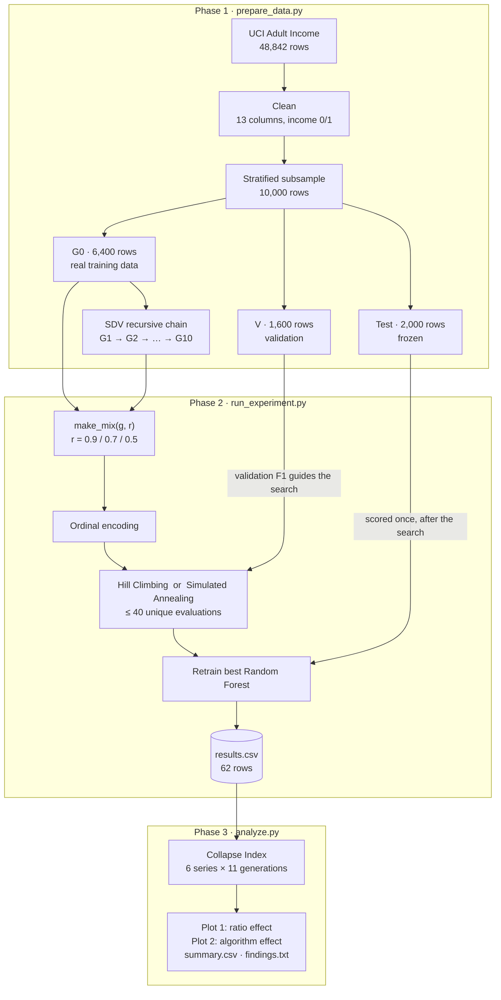
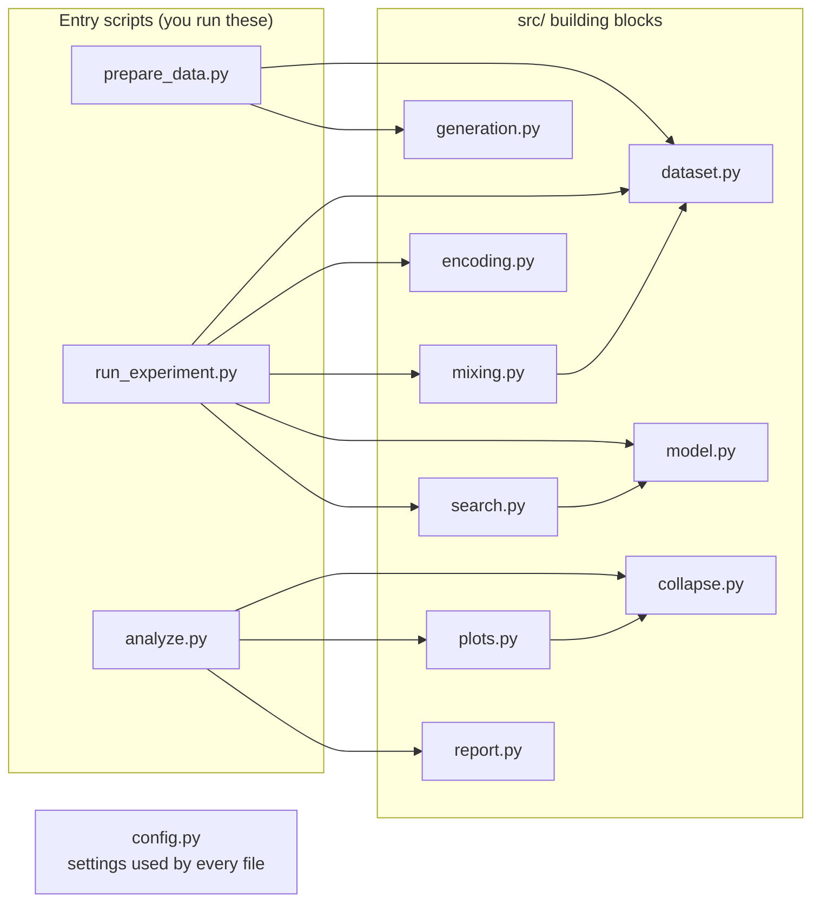

# BlackMirror

### Does a model trained on AI-generated data slowly lose touch with reality?

BlackMirror studies **recursive synthetic data**. A model learns from real data and generates fake data; the next model learns from *that* fake data; and so on for 10 generations. At each generation we train a Random Forest on a mix of real and synthetic rows, tune it with two AI search algorithms (**Hill Climbing** and **Simulated Annealing**), and check how well it still predicts **real** people.

> **Research question:** How do the synthetic-data ratio and the optimization algorithm affect predictive performance and degradation across generations?

**Repository:** https://github.com/Ramprasath-0103/blackmirror

---

## Table of contents

1. [Project idea](#1-project-idea)
2. [Tech stack](#2-tech-stack)
3. [Implementation](#3-implementation)
4. [Architecture and workflow](#4-architecture-and-workflow)
5. [Getting started](#5-getting-started)
6. [Results](#6-results)
7. [Output files](#7-output-files)
8. [Configuration](#8-configuration)
9. [Reproducibility and built-in checks](#9-reproducibility-and-built-in-checks)
10. [Important design decisions](#10-important-design-decisions)
11. [Troubleshooting](#11-troubleshooting)
12. [Glossary](#12-glossary)
13. [Team and contributions](#13-team-and-contributions)
14. [Acknowledgements](#14-acknowledgements)

---

## 1. Project idea

### The problem

Imagine photocopying a photocopy. The first copy looks fine, but each new copy loses a little detail, and after enough rounds the picture is blurry. Researchers worry that machine-learning models could go the same way as more of the data they learn from is produced by other models. This effect is often called **model collapse**.

### What we do

We recreate the "photocopy of a photocopy" process with a table of real census data:

```
real data (G0) ──► synthetic G1 ──► synthetic G2 ──► … ──► synthetic G10
                   learned from G0  learned from G1 only   learned from G9 only
```

At every generation we:

1. **Mix** real and synthetic rows in three ratios: **90/10**, **70/30** and **50/50** (real/synthetic).
2. **Tune** a Random Forest on the mix with **Hill Climbing** and with **Simulated Annealing**.
3. **Test** the tuned model once on real people it has never seen.
4. **Measure** the loss against a model trained on 100% real data. This is the **Collapse Index**.

### What we compare

| Factor (what we change) | Levels |
|---|---|
| Synthetic-data ratio | 90/10, 70/30, 50/50 |
| Optimization algorithm | Hill Climbing, Simulated Annealing |
| Generation | G1 to G10, plus the G0 baseline |

| Outcome (what we measure) | How |
|---|---|
| Predictive performance | Accuracy, precision, recall and F1 on a frozen real test set |
| Degradation | Collapse Index: relative F1 loss against the baseline |
| Search quality | Validation F1 each algorithm found, and how many evaluations it used |

### Key finding (short version)

- The model's test F1 did **not** clearly degrade over 10 generations. The Collapse Index stays between −2.7% and +5.7% and moves up and down rather than rising.
- **Simulated Annealing matched or beat Hill Climbing in 27 of 30 runs.**
- Hill Climbing stopped at a local optimum in every run. Its worst trap caused the **biggest Collapse Index spike in the whole experiment**.

The details are in [Results](#6-results).

---

## 2. Tech stack

| Tool | Version | What it's used for | Where in the code |
|---|---|---|---|
| **Python** | 3.12 | The language for everything | — |
| **pandas** | 2.3.3 | Reading, cleaning, mixing and saving tables (CSV files) | everywhere |
| **ucimlrepo** | 0.0.7 | Downloading the official Adult Income dataset from UCI | `src/dataset.py` |
| **scikit-learn** | 1.9.1 | Stratified splits, `OrdinalEncoder`, `RandomForestClassifier`, F1 and other metrics | `src/dataset.py`, `src/encoding.py`, `src/model.py` |
| **SDV** (Synthetic Data Vault) | 1.38.5 | `GaussianCopulaSynthesizer`, which creates the synthetic generations | `src/generation.py` |
| **NumPy** | 2.x (installed with the above) | The seeded random number generator used by Simulated Annealing | `src/search.py` |
| **matplotlib** | 3.11.2 | The two result plots | `src/plots.py` |

All versions are pinned in [`requirements.txt`](requirements.txt), so every team member gets the same numbers.

**Dataset:** [Adult Income](https://archive.ics.uci.edu/dataset/2/adult) from the UCI Machine Learning Repository. It contains 48,842 people from the 1994 US census, and the task is to predict whether a person earns more than $50K a year.

---

## 3. Implementation

The project runs in **three phases**. Each phase is one script, and each script writes files that the next phase reads.

### Phase 1: Data and generation (`prepare_data.py`)

| Step | What happens | Why |
|---|---|---|
| **1. Load** | `fetch_ucirepo(id=2)`, then features and target are joined into one table | Uses the official UCI copy, so there's no manual downloading |
| **2. Clean** | Drop `fnlwgt` and `education`. Turn `NaN` and `"?"` into `"Unknown"`. Fix the label (`">50K."` becomes `">50K"`) and map it to **1 = >50K, 0 = <=50K** | `fnlwgt` describes how a person was sampled, not the person. `education` duplicates `education-num`. No rows are lost. The raw label has 4 spellings |
| **3. Split** | Stratified sample of 10,000 rows, split into **Test 2,000**, **V 1,600** and **G0 6,400** | Every set keeps the same share of >50K people (about 24%) |
| **4. Metadata** | Tell SDV the type of every column explicitly | Otherwise SDV might treat `income` (0/1) as a number and generate values like 0.37 |
| **5. Recursive chain** | For g = 1…10, a **fresh** `GaussianCopulaSynthesizer` is fitted on generation g−1 and samples 6,400 rows | Each generation sees only the previous one, so errors pile up |
| **6. Checks** | Columns, missing values, labels, row counts, >50K rate and file fingerprints | Catches problems before Phase 2 uses the data |

After cleaning there are **13 columns**: 12 features plus `income`.

| Set | Rows | Used for | Never used for |
|---|---|---|---|
| **G0** | 6,400 | Seeding SDV, the real part of every mix, the baseline | Scoring |
| **V** (validation) | 1,600 | Scoring hyperparameters during the search | Training, generation |
| **Test** | 2,000 | The final score, once per run | Training, generation, search |

**How SDV makes fake rows.** For each column, `GaussianCopulaSynthesizer` learns its shape: a smooth curve for numbers, and for categories a slice of the 0–1 range sized by how common each one is. It also learns a table of how strongly each pair of columns moves together. To generate a fake person, it draws linked random numbers and converts each one back into a value for its column.

**Mixing.** `make_mix(g, r)` builds a 6,400-row training set from `r × 6,400` real rows from G0 and the rest from generation `g`, then shuffles it. For a given ratio the **same real rows** are used at every generation, so the only thing that changes is where the synthetic rows come from.

### Phase 2: Optimization and evaluation (`run_experiment.py`)

**Encoding.** A Random Forest needs numbers, so an `OrdinalEncoder` turns each category into an integer code (for example "Private" becomes 3). It is fitted **once** on G0 and reused for every run. A category it has never seen gets the code −1 instead of crashing the program.

**Search space.** There are 6 × 6 × 5 = **180** possible Random Forest configurations:

| Hyperparameter | Options | What it controls |
|---|---|---|
| `n_estimators` | 50, 100, 150, 200, 250, 300 | How many trees vote |
| `max_depth` | 2, 4, 6, 8, 10, None (no limit) | How many questions in a row each tree may ask |
| `min_samples_split` | 2, 4, 6, 8, 10 | The smallest group a tree may still split |

**Search as an AI problem.** Think of a 3-D chessboard with 180 squares. Each square has a hidden height, its F1 score, and the only way to learn a square's height is to train a forest there.

| Concept | Definition |
|---|---|
| State | Three positions in the grid, e.g. `(1, 1, 0)` |
| Initial state | `(1, 1, 0)`, meaning 100 trees, depth 4, split 2 |
| Action | Move one hyperparameter one step up or down |
| Neighbours | Every state one action away. There are at most 6 (3 settings × 2 directions) |
| Evaluation | F1 on the validation set V |
| Goal | The highest F1 |
| Termination | 40 unique evaluations, or no better neighbour (Hill Climbing) |

**The objective** trains a forest with the state's settings on the mix and returns its F1 on V. It keeps a **cache** of every score, so a repeated state is free and only **unique** evaluations count towards the budget of 40.

**Hill Climbing** (steepest ascent) checks every door and goes through the best one, but only if it leads uphill:

```
current = START
loop:
    score every neighbour of current                (already-scored ones are free)
    if the best neighbour is strictly better: move there
    else: stop                                      ← local optimum
```

**Simulated Annealing** opens one random door. It always goes through if the door leads uphill. If the door leads downhill, it *sometimes* goes through anyway, which is likely early on and almost never later:

```
current = best = START,  T = 0.05
while budget is left:
    pick ONE random neighbour and score it          Δ = new F1 − current F1
    if Δ > 0: move there
    else: move there anyway if a random roll in [0, 1) is below exp(Δ / T)
    remember the best state ever seen
    T = T × 0.9                                     ← cool down
```

How the temperature changes the chance of accepting a typical small drop (Δ = −0.01):

| Moment | T | Chance of accepting |
|---|---|---|
| Start | 0.05 | 82%, so it explores freely |
| After 20 steps | 0.006 | 19% |
| After 40 steps | 0.0007 | about 1 in a million, so it only climbs now |

Both algorithms use the same start, neighbours, budget and objective. Only the rule for accepting a move differs, so any difference in results comes from the algorithm.

#### Worked example: one real run (generation 4, 50/50 mix)

States are written as (trees, depth, split), and the number is the validation F1.

**Hill Climbing:**

| Round | Standing at | Neighbours scored | Decision |
|---|---|---|---|
| 1 | (100, 4, 2) **0.417** | (50,4,2) 0.422 · (150,4,2) 0.405 · (100,2,2) 0.000 · **(100,6,2) 0.522** · (100,4,4) 0.420 | best is better → **move** |
| 2 | (100, 6, 2) **0.522** | (50,6,2) 0.529 · (150,6,2) 0.522 · (100,4,2) cached · **(100,8,2) 0.595** · (100,6,4) 0.520 | best is better → **move** |
| 3 | (100, 8, 2) **0.595** | (50,8,2) 0.587 · (150,8,2) 0.588 · (100,6,2) cached · **(100,10,2) 0.594** · (100,8,4) 0.572 | 0.594 < 0.595 → **stop** |

Hill Climbing finished at **0.595** after 14 evaluations. It missed by 0.001 and never reached "no depth limit".

**Simulated Annealing** (key steps; ★ = new best ever):

| Step | T | Tried | F1 | Δ | Chance / roll | Decision |
|---|---|---|---|---|---|---|
| 1 | 0.050 | (50, 4, 2) | 0.422 | +0.005 | — | better → move ★ |
| 4 | 0.037 | (50, 6, 6) | 0.515 | −0.011 | 74% / 0.70 | moved **downhill** |
| 5 | 0.033 | (50, 4, 6) | 0.422 | −0.094 | 6% / 0.98 | stay (a big drop is rarely accepted) |
| 14 | 0.013 | (50, 10, 2) | 0.583 | −0.003 | 77% / 0.44 | moved **downhill** to depth 10, which HC refused |
| 16 | 0.010 | (100, 8, 2) | 0.595 | +0.009 | — | ★ where HC stopped |
| 26 | 0.004 | (150, 10, 6) | 0.603 | −0.003 | 41% / 0.04 | lucky roll → moved downhill |
| 27 | 0.003 | (150, None, 6) | 0.618 | +0.015 | — | ★ |
| 28 | 0.003 | (100, None, 6) | **0.633** | +0.015 | — | ★ final best |
| 29+ | → 0 | | | | almost 0 | frozen: only stays or revisits |

Simulated Annealing finished at **0.633** after 24 evaluations, which was **0.670 on Test**. Hill Climbing's result was 0.621 on Test. Two small downhill steps are what made the difference.

**Final evaluation.** The best settings are used to retrain the forest, which then predicts the **Test** set **once**. Accuracy, precision, recall and F1 are appended as one row to `results/results.csv`.

**How F1 is calculated.** Here it is for the baseline model on Test (2,000 people, 479 of whom really earn >50K):

| | Model says >50K | Model says ≤50K |
|---|---|---|
| **Really >50K** | TP = 271 | FN = 208 |
| **Really ≤50K** | FP = 73 | TN = 1,448 |

```
Precision = TP / (TP + FP) = 271 / 344 = 0.788     "when it says >50K, it is right 79% of the time"
Recall    = TP / (TP + FN) = 271 / 479 = 0.566     "it finds 57% of the people earning >50K"
F1        = 2 × P × R / (P + R)        = 0.659     (shortcut: 2·TP / (2·TP + FP + FN) = 542 / 823)
```

We use F1 rather than accuracy because a lazy model that always says "≤50K" gets 76% accuracy but an F1 of 0.

**The grid of runs:**

```
1 baseline (G0, 100% real)  +  10 generations × 3 ratios   =  31 training mixes
31 mixes × 2 algorithms                                    =  62 runs
```

### Phase 3: Degradation and analysis (`analyze.py`)

**Collapse Index.** There are 6 series (3 ratios × 2 algorithms), each with 11 points (G0 to G10):

```
CI_g = (F1_base − F1_g) / F1_base        F1_base = baseline test F1 of the SAME algorithm
```

| Value | Meaning |
|---|---|
| CI = 0.10 | 10% worse than training on real data only |
| CI = 0 | No change |
| CI < 0 | Slightly better than the baseline. This is a legitimate result, so the sign is kept |

**Outputs:**
- Plot 1 shows the **ratio effect**.
- Plot 2 shows the **algorithm effect**.
- A summary table.
- A plain-English `findings.txt` that answers both parts of the research question.

---

## 4. Architecture and workflow

### 4.1 End-to-end workflow



### 4.2 Code architecture

The three **entry scripts** in the main folder are short recipes. All the logic lives in small, single-purpose modules in **`src/`**, and every file reads its settings from **`config.py`**.



### 4.3 Project structure

```
blackmirror/
│
├── README.md              ← you are here
├── requirements.txt       ← libraries to install (exact versions)
├── config.py              ← ALL settings: seeds, sizes, column names, search grid, file paths
│
├── prepare_data.py        ← PHASE 1  run first
├── run_experiment.py      ← PHASE 2  run second
├── analyze.py             ← PHASE 3  run third
│
├── src/                   ← building blocks used by the three scripts
│   ├── dataset.py         ← load, clean and split the real data; read saved files
│   ├── generation.py      ← SDV metadata and the recursive synthetic chain
│   ├── mixing.py          ← make_mix(): real + synthetic rows at a given ratio
│   ├── encoding.py        ← text categories → numbers
│   ├── model.py           ← train a Random Forest; F1, precision, recall, accuracy
│   ├── search.py          ← search space, objective, Hill Climbing, Simulated Annealing
│   ├── collapse.py        ← the Collapse Index
│   ├── plots.py           ← the two figures
│   └── report.py          ← summary table and written findings
│
├── data/                  ← created by Phase 1 (G0–G10, val, test, metadata.json); not stored in git
└── results/               ← created by Phases 2 and 3 (CSVs, findings.txt, plots/)
```

### 4.4 How the phases hand over data

The phases only talk to each other through files. This makes each phase easy to run, check and rerun on its own.

| File | Written by | Read by |
|---|---|---|
| `data/G0.csv` | Phase 1 | Phase 2: fitting the encoder, the real part of every mix |
| `data/G1.csv` … `data/G10.csv` | Phase 1 | Phase 2: the synthetic part of every mix |
| `data/val.csv` | Phase 1 | Phase 2: the search objective |
| `data/test.csv` | Phase 1 | Phase 2: the final evaluation only |
| `results/results.csv` | Phase 2 | Phase 3 |
| `results/collapse_index.csv`, `summary.csv`, `findings.txt`, `plots/` | Phase 3 | You |

### 4.5 Where each part of the plan lives

| Plan section | File | Main function(s) |
|---|---|---|
| Shared constants | `config.py` | — |
| 1.1 Load / 1.2 Clean / 1.3 Split | `src/dataset.py` | `load_adult()`, `clean_adult()`, `split_dataset()` |
| 1.4 SDV metadata / 1.5 Recursive chain | `src/generation.py` | `build_metadata()`, `generate_chain()` |
| 1.6 Mixer | `src/mixing.py` | `make_mix()` |
| 2.1 Encoding | `src/encoding.py` | `fit_encoder()`, `to_xy()` |
| 2.2 Search space and objective | `src/search.py` | `neighbors()`, `Objective` |
| 2.3 Hill Climbing | `src/search.py` | `hill_climbing()` |
| 2.4 Simulated Annealing | `src/search.py` | `simulated_annealing()` |
| 2.5 Final evaluation | `run_experiment.py`, `src/model.py` | `run_one()`, `test_metrics()` |
| 2.6 Run the grid | `run_experiment.py` | `main()` |
| 3.1 Collapse Index | `src/collapse.py` | `collapse_index_table()` |
| 3.2 Plots, table, interpretation | `src/plots.py`, `src/report.py` | `plot_collapse_index()`, `plot_hc_vs_sa()`, `build_summary()`, `write_findings()` |

The plan's original LSTM forecasting step has been removed (see [Scope](#scope)).

### 4.6 How to read the code

1. **Start with `config.py`** to see every setting in one place.
2. **Read the three entry scripts in order.** Each one prints and runs numbered steps (Step 1/6, Step 2/6 …).
3. **For the search algorithms, read `src/search.py` from top to bottom.** It goes search space → objective → Hill Climbing → Simulated Annealing, each with a short explanation.

---

## 5. Getting started

### Prerequisites

| You need | Notes |
|---|---|
| **Python 3.12** | The version this project was tested with. Check with `python3 --version` |
| **Git** | To clone the repository |
| **Internet access** | Only for installing the libraries and for the first data download |
| **About 1 GB of free disk space** | Mostly PyTorch, which SDV installs automatically |

### Step 1: Clone the repository

```bash
git clone https://github.com/Ramprasath-0103/blackmirror.git
```

```bash
cd blackmirror
```

### Step 2: Create a virtual environment

A virtual environment is a private folder for this project's libraries, so they don't clash with anything else on your computer. On Windows, use `py -3.12 -m venv .venv` instead.

```bash
python3.12 -m venv .venv
```

### Step 3: Activate it

Do this every time you open a new terminal. On Windows, use `.venv\Scripts\activate` instead. Your prompt should now start with `(.venv)`.

```bash
source .venv/bin/activate
```

### Step 4: Install the libraries

```bash
pip install -r requirements.txt
```

### Step 5: Run the three phases in order

```bash
python prepare_data.py
```

```bash
python run_experiment.py
```

```bash
python analyze.py
```

| Script | What it does | Time on a laptop* |
|---|---|---|
| `prepare_data.py` | Downloads the data, splits it, generates G1–G10, checks the files | about 1 minute |
| `run_experiment.py` | 62 searches plus test evaluations, then the checks | about 3–4 minutes |
| `analyze.py` | Collapse Index, plots, summary and findings | a few seconds |

\*Measured on an Apple Silicon Mac. Slower machines can take several times longer, and that's fine.

### What you should see

`prepare_data.py` ends with a check table:

```
Step 6/6  Checking the files
  file     rows    >50K   fingerprint
  test    2,000   23.9%   2c02b1b858
  G0      6,400   23.9%   371a77859d
  ...
  G10     6,400   25.5%   927cb8007a

  All checks passed: 13 columns, no NaN, income in {0, 1}, 6,400 rows per generation.
```

`run_experiment.py` prints one line per run and then its checks:

```
[ 1/62] G0  real=100%  HC  val F1 0.666  test F1 0.659  evals 13  (trees=150, depth=6, split=2)  1s
...
Checks
  rows in results.csv: 62 (expected 62)
  largest evals_used:  32 (must be <= 40)
  baseline test F1 (HC): 0.659  OK
  re-running G9 ratio=0.9 HC to check it reproduces ... identical
```

`analyze.py` prints the summary table and the findings. When it finishes, open **`results/findings.txt`** and the two images in **`results/plots/`**.

---

## 6. Results

These numbers come from running the three scripts exactly as described above. With the versions in `requirements.txt` you should get the same numbers.

### Plot 1: Collapse Index by generation (ratio effect)

Colour shows the ratio. Solid lines are Hill Climbing and dashed lines are Simulated Annealing. Above 0% means worse than the baseline.


### Plot 2: Hill Climbing vs Simulated Annealing (algorithm effect)

Each dot is one training mix. Dots above the dashed line mean SA got the higher value, and dots on the line mean a tie. The left panel shows the validation F1 each algorithm found; the right panel shows how many evaluations each used.


### Summary table

| Real/synthetic | Algorithm | Mean val F1 | Mean evaluations | Test F1 at G5 | Test F1 at G10 | CI at G5 | CI at G10 | Mean CI over G1–G10 |
|---|---|---|---|---|---|---|---|---|
| 90/10 | HC | 0.656 | 20.8 | 0.664 | 0.648 | −0.9% | +1.6% | −0.3% |
| 90/10 | SA | 0.658 | 24.0 | 0.677 | 0.669 | −2.7% | −1.4% | −1.2% |
| 70/30 | HC | 0.627 | 22.8 | 0.665 | 0.664 | −1.0% | −0.9% | −0.1% |
| 70/30 | SA | 0.633 | 23.5 | 0.665 | 0.664 | −0.9% | −0.8% | −0.7% |
| 50/50 | HC | 0.628 | 22.6 | 0.654 | 0.670 | +0.6% | −1.7% | +0.1% |
| 50/50 | SA | 0.633 | 26.6 | 0.654 | 0.670 | +0.7% | −1.6% | −1.0% |

The baseline (100% real data) test F1 is **0.659** for both algorithms.

### What we found

**Ratio effect**
- The model's test F1 did **not** clearly degrade over 10 generations. Every Collapse Index value stays between −2.7% and +5.7%, and the values move up and down rather than climbing.
- The mean CI does not grow steadily as the synthetic share increases.
- The clearer ratio effect is on the *validation* F1 the search reached: about 0.66 with 10% synthetic data, against about 0.63 with 30% or 50%.

**Algorithm effect**
- Simulated Annealing found a validation F1 at least as good as Hill Climbing in **27 of 30** synthetic runs: higher in 11 and equal in 16. It also had a slightly lower (better) mean Collapse Index at every ratio.
- **Hill Climbing stopped at a local optimum in all 31 of its runs**, always with budget left over.
- **The biggest Collapse Index in the experiment (+5.7%, G4 50/50) is a Hill Climbing trap.** On the same training data, Simulated Annealing scored −1.6%. The worked example in [Section 3](#worked-example-one-real-run-generation-4-5050-mix) shows that exact run.
- **Fairness caveat:** SA used a few more evaluations on average (24.7 against 21.8, out of 40). Part of its advantage may come from simply trying more settings.

**Data drift.** The share of >50K rows drifts from 23.9% in G0 to 25.5% in G10. Keep this in mind when reading small F1 changes.

The full auto-generated text is in `results/findings.txt`.

---

## 7. Output files

| File | Made by | Contents |
|---|---|---|
| `data/G0.csv` … `data/G10.csv` | Phase 1 | Real (G0) and synthetic (G1–G10) training data, 6,400 rows each |
| `data/val.csv`, `data/test.csv` | Phase 1 | Real validation (1,600) and test (2,000) rows |
| `data/metadata.json` | Phase 1 | The column types given to SDV |
| `results/results.csv` | Phase 2 | One row per run (62 in total) |
| `results/collapse_index.csv` | Phase 3 | Test F1 and Collapse Index for every series and generation |
| `results/summary.csv` | Phase 3 | One row per ratio × algorithm, the key numbers at a glance |
| `results/findings.txt` | Phase 3 | The research question answered in plain English |
| `results/plots/ci_vs_generation.png` | Phase 3 | Plot 1: ratio effect |
| `results/plots/hc_vs_sa.png` | Phase 3 | Plot 2: algorithm effect |

### Columns in `results.csv`

| Column | Meaning |
|---|---|
| `generation` | 0 = baseline (pure real data), 1–10 = the synthetic generation in the mix |
| `ratio` | Share of real rows in the training mix (1.0, 0.9, 0.7 or 0.5) |
| `algorithm` | `HC` (Hill Climbing) or `SA` (Simulated Annealing) |
| `n_estimators`, `max_depth`, `min_samples_split` | The best hyperparameters found |
| `val_f1` | F1 of those settings on V, the score the search maximised |
| `test_accuracy`, `test_precision`, `test_recall`, `test_f1` | Final scores on the frozen Test set |
| `evals_used` | Unique settings the search tried (never more than 40) |

---

## 8. Configuration

Every setting lives in [`config.py`](config.py). No number such as a seed, size or file name is typed anywhere else.

| You want to… | Change |
|---|---|
| Use a different random seed | `SEED` |
| Try a bigger search budget | `EVAL_BUDGET` |
| Run more generations | `N_GENERATIONS` |
| Test other mixtures | `RATIOS` |
| Search other hyperparameter values | `GRID`, `START_STATE` |
| Make SA explore more or less | `SA_START_TEMPERATURE`, `SA_COOLING_RATE` |

> ⚠️ After changing anything that affects Phase 1 or 2, **delete `results/results.csv`** and run the scripts again. Otherwise `run_experiment.py` will skip runs it thinks are already finished.

---

## 9. Reproducibility and built-in checks

Every random step uses `SEED = 42`, and the library versions are pinned, so the same code gives the same numbers on every run. Each script also checks its own output against the plan's "done when" list:

| Script | What it checks automatically |
|---|---|
| `prepare_data.py` | 13 columns, no missing values, `income` only 0/1, 6,400 rows per generation. It prints the >50K rate of every file and a **fingerprint** of each file: run it twice, and identical fingerprints mean identical files |
| `run_experiment.py` | 62 rows, every `evals_used` ≤ 40, baseline test F1 in the expected 0.65–0.70 range. It also **re-runs one random run** and confirms it gives exactly the same row |
| `analyze.py` | Refuses to start until `results.csv` has all 62 rows |

**Safe to interrupt.** `run_experiment.py` saves each row as soon as it's computed and skips finished runs when restarted, so a crash or a sleeping laptop only loses the run in progress.

---

## 10. Important design decisions

| Decision | Why |
|---|---|
| **Test is used once per run, after the search** | The search never sees Test, so the final score is unbiased |
| **The search is scored on V, not Test** | V guides tuning, and Test only measures the result |
| **A fresh synthesizer for every generation** | Each generation learns from the previous one only, which is what makes the chain recursive |
| **Column types are set by hand for SDV** | Stops `income` being generated as 0.37, and keeps `capital-gain` and `capital-loss` (about 90% zeros) numerical |
| **The same real rows for every generation at a given ratio** | Isolates the effect of the generation from the effect of which real rows were drawn |
| **The encoder is fitted once on G0** | Every run uses identical codes, and unseen categories become −1 instead of crashing |
| **Random Forest as the model** | Three meaningful settings make a real search problem for HC and SA. It also takes numbers and categories without scaling, and is stable and reproducible with a seed |
| **Neighbours change one setting by one step** | Keeps each step cheap (at most 6 choices). The trade-off is that improvements needing two settings to change at once are invisible |
| **Only unique evaluations count towards the budget** | Hill Climbing re-checks neighbours often, so caching keeps the HC vs SA comparison fair |
| **SA has a safety cap (`SA_MAX_STEPS`)** | Once cooled, SA can sit on a peak where every neighbour is already scored. Repeats are free, so the budget never runs out and the loop would never end. The cap stops it, which is why SA sometimes uses fewer than 40 evaluations |
| **SA returns the best state ever seen** | SA can walk downhill, so where it ends is not always where it was best |
| **T₀ = 0.05, cooling × 0.9 per step** | Typical F1 differences are about 0.01, so early on SA accepts small drops about 82% of the time, and after about 40 steps almost never |
| **The Collapse Index uses the same algorithm's baseline** | A difference between HC and SA is never mistaken for collapse |
| **Negative Collapse Index values are kept** | Synthetic data slightly helping is a legitimate result |

### Scope

**Components kept:**
- the Adult Income dataset and a frozen test split;
- SDV recursive generation and 3 real/synthetic ratios;
- Random Forest, tuned by Hill Climbing and by Simulated Annealing;
- accuracy, precision, recall and F1;
- the Collapse Index.

**Components dropped:**
- feature drift, SHAP and synthetic-data quality metrics;
- **LSTM forecasting.** It was removed to keep the focus on the two search algorithms. An earlier version included it, and its forecasts were no more accurate than simply predicting the average Collapse Index.

---

## 11. Troubleshooting

| Problem | Fix |
|---|---|
| `pip install` fails | Use **Python 3.12**, the version the project was tested with. Very new Python versions may not have ready-made packages yet |
| `ModuleNotFoundError: No module named 'pandas'` (or `sdv`, `sklearn`…) | The virtual environment isn't active. Run `source .venv/bin/activate` (on Windows, `.venv\Scripts\activate`) |
| You moved or renamed the project folder and nothing runs | A virtual environment remembers its original location. Delete `.venv` and repeat Steps 2–4 |
| `ModuleNotFoundError: No module named 'src'` or `'config'` | Run the scripts from the project folder, e.g. `python run_experiment.py`, and don't run files inside `src/` directly |
| `prepare_data.py` can't download the data | Phase 1 needs internet access to `archive.ics.uci.edu`. Check your connection and try again |
| `results.csv not found` or `expected 62 rows` from `analyze.py` | Run (or finish) `python run_experiment.py` first |
| My numbers differ from the README | Install the exact versions in `requirements.txt`. A different SDV version can generate different rows |

---

## 12. Glossary

| Term | Meaning |
|---|---|
| **Synthetic data** | Made-up rows produced by a model that has learned the patterns of real data |
| **SDV / GaussianCopula** | The library (Synthetic Data Vault) and the statistical method we use to generate synthetic tables |
| **Generation (G0…G10)** | G0 is real data. G*n* is synthetic data learned from G*n−1* |
| **Ratio** | Share of real rows in a training mix. 0.7 means 70% real and 30% synthetic, shown as "70/30" |
| **Stratified split** | A split that keeps the same share of each class in every part |
| **Random Forest** | Many decision trees, each trained on a random sample of rows, that vote together. Our prediction model |
| **Hyperparameter** | A setting chosen *before* training, such as the number of trees |
| **State** | One combination of hyperparameters, written as positions in the grid |
| **Neighbour** | A state that differs by one step in one hyperparameter |
| **Evaluation / budget** | Training and scoring one state. Each search may make 40 unique evaluations |
| **Hill Climbing** | A search that always moves to the best neighbour and stops when nothing is better |
| **Simulated Annealing** | A search that sometimes accepts worse moves early on to escape local optima |
| **Temperature (T)** | Simulated Annealing's willingness to accept worse moves. It shrinks every step |
| **Local optimum** | A state better than all its neighbours but not the best overall |
| **Precision** | Of the people predicted to earn >50K, the share who really do: TP / (TP + FP) |
| **Recall** | Of the people who really earn >50K, the share we found: TP / (TP + FN) |
| **F1 score** | One number that balances precision and recall: 2·P·R / (P + R) |
| **Collapse Index (CI)** | Relative loss of test F1 against the baseline |

---

## 13. Team and contributions

| Member | Role | Plan sections | Files and functions |
|---|---|---|---|
| **Ram** | Data, generation and Simulated Annealing | 1.1–1.6, 2.4 | `prepare_data.py`, `src/dataset.py`, `src/generation.py`, `src/mixing.py`, `simulated_annealing()` in `src/search.py` |
| **Amogh** | Search framework, Hill Climbing and the experiment runner | 2.1–2.3, 2.6 | `run_experiment.py`, `src/encoding.py`, `state_to_params()`, `neighbors()`, `Objective` and `hill_climbing()` in `src/search.py` |
| **Nehal** | Model evaluation and analysis | 2.5, 3.1–3.2 | `analyze.py`, `src/model.py`, `src/collapse.py`, `src/plots.py`, `src/report.py` |

**Any member may be asked about any part.** Everyone should be able to explain [Section 3](#3-implementation), especially the worked example of Hill Climbing and Simulated Annealing.

**The contract between phases.** `config.py`, the file names in `data/` and `results/`, and the columns of `results.csv` are shared by everyone. If one person changes a seed or a column name, another person's code can silently break or produce numbers that can't be compared. **Agree with the team before changing them.**

**Before pushing a change,** run all three scripts and make sure every check still passes.

---

## 14. Acknowledgements

- **Dataset:** Becker, B. & Kohavi, R. (1996). *Adult* [Dataset]. UCI Machine Learning Repository. https://doi.org/10.24432/C5XW20
- **Synthetic data:** [SDV, the Synthetic Data Vault](https://docs.sdv.dev/)
