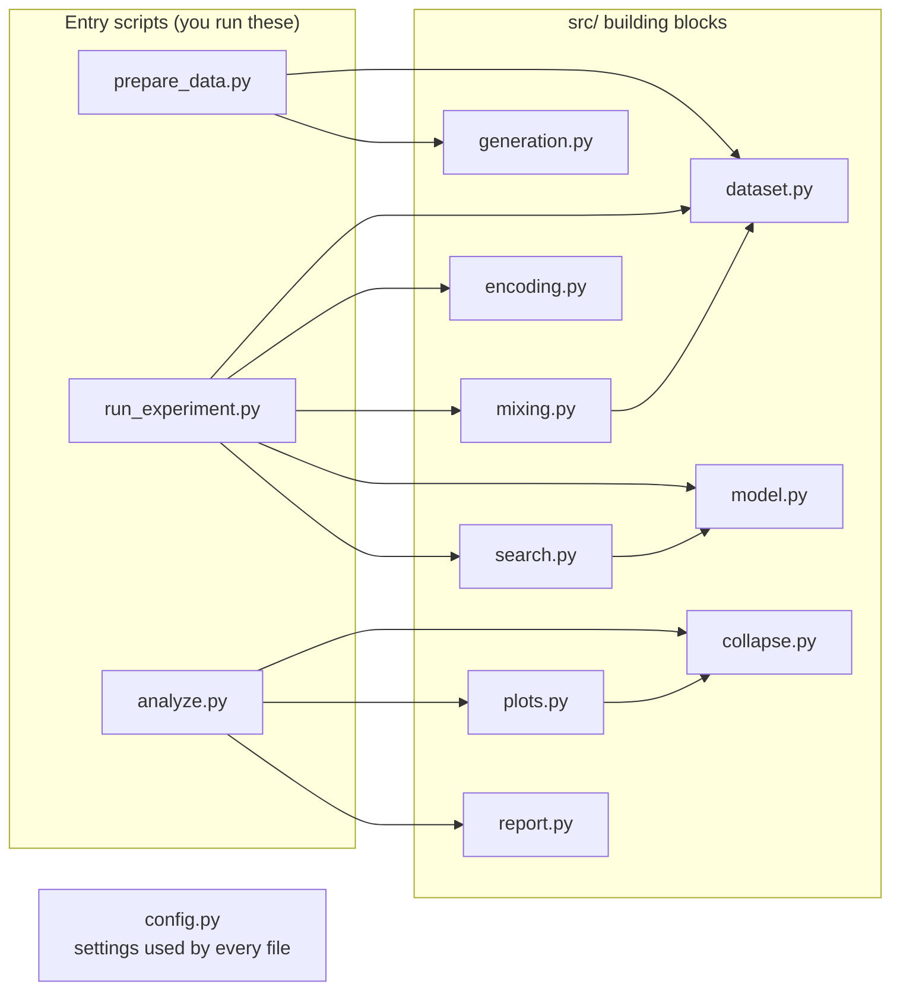
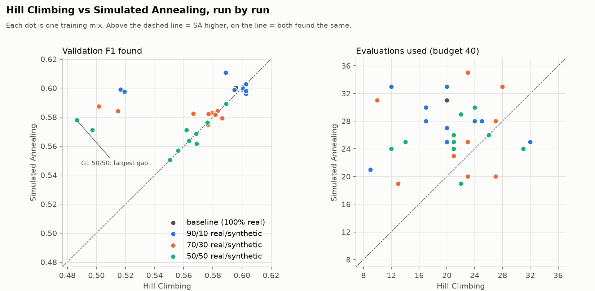

# BlackMirror

### Does a model trained on AI-generated data slowly lose touch with reality?

BlackMirror tests what happens when synthetic data is made from synthetic data, over and over. One model learns from real data and generates fake data; the next model learns from *that* fake data; and so on for 10 generations. At each generation we train a Random Forest on a mix of real and synthetic rows, tune it with two AI search algorithms (**Hill Climbing** and **Simulated Annealing**), and test it on real people.

> **Research question:** How do the synthetic-data ratio and the optimization algorithm affect predictive performance and degradation across generations?

**Repository:** https://github.com/Ramprasath-0103/blackmirror

**Two ways to run it:** the three command-line scripts, or a web app (`python app.py`) that runs the same scripts from your browser and lets you watch both search algorithms step by step ([6.5](#65-the-web-app)).

**At a glance**
- **More synthetic data, more damage.** Average test F1 falls from **0.631** with 100% real data to **0.610** (90/10 real/synthetic), **0.590** (70/30) and **0.575** (50/50).
- **Simulated Annealing beats Hill Climbing at every ratio:** it finds higher validation F1 and has less damage. Hill Climbing got stuck on a local optimum in all 31 of its runs.
- **The damage appears at the first generation and then stays level.** It doesn't keep growing from G1 to G10.

---

## Contents

| Understand | Run | Results | Reference |
|---|---|---|---|
| [1. Project idea](#1-project-idea) | [6. Getting started](#6-getting-started) | [7. Results](#7-results) | 
| [2. Tech stack](#2-tech-stack) | [8. Configuration and reproducibility](#8-configuration-and-reproducibility) | [9. Design decisions and scope](#9-design-decisions-and-scope) 
| [3. Dataset](#3-dataset) | | | [10. Team and contributions](#10-team-and-contributions) |
| [4. Implementation](#4-implementation) | 
| [5. Architecture and workflow](#5-architecture-and-workflow) | | | |

---

## 1. Project idea

### 1.1 The problem
Imagine photocopying a photocopy. Each new copy loses a little detail, and after enough rounds the picture is blurry. Researchers worry that machine-learning models could go the same way as more of their training data is produced by other models. This is called **model collapse**.

### 1.2 What we do
We recreate the "photocopy of a photocopy" process with real census data:

```
real data (G0) ──► synthetic G1 ──► synthetic G2 ──► … ──► synthetic G10
                   learned from G0  learned from G1 only   learned from G9 only
```

At every generation we:
1. **Mix** real and synthetic rows in three ratios: **90/10**, **70/30**, **50/50** (real/synthetic).
2. **Tune** a Random Forest on the mix with **Hill Climbing** and with **Simulated Annealing**.
3. **Test** the tuned model once on real people it has never seen.
4. **Measure** the loss against a model trained on 100% real data. This is the **Collapse Index**.

### 1.3 What we vary and what we measure

| | |
|---|---|
| **We vary** | the real/synthetic ratio (90/10, 70/30, 50/50) · the search algorithm (HC, SA) · the generation (G1–G10, plus the G0 baseline) |
| **We measure** | test accuracy, precision, recall and F1 on real data · the Collapse Index · the validation F1 each algorithm found and how many evaluations it used |

---

## 2. Tech stack

| Tool | Version | Used for | Where |
|---|---|---|---|
| **Python** | 3.12 | Everything | — |
| **pandas** | 2.3.3 | Reading, cleaning, mixing and saving tables | everywhere |
| **ucimlrepo** | 0.0.7 | Downloading the dataset from UCI | `src/dataset.py` |
| **scikit-learn** | 1.9.1 | Stratified splits, `OrdinalEncoder`, `RandomForestClassifier`, metrics | `src/dataset.py`, `src/encoding.py`, `src/model.py` |
| **SDV** | 1.38.5 | `GaussianCopulaSynthesizer`, which creates the synthetic generations | `src/generation.py` |
| **NumPy** | 2.x (comes with the above) | The seeded random numbers used by Simulated Annealing | `src/search.py` |
| **matplotlib** | 3.11.2 | The two plots | `src/plots.py` |
| **Flask** | 3.1.3 | The small local server behind the web app | `web/server.py` |
| **HTML, CSS, JavaScript** | — | The web app's page and interactive charts (no build step, no frameworks) | `web/static/` |

Exact versions are pinned in [`requirements.txt`](requirements.txt), so everyone gets the same numbers.

---

## 3. Dataset

### 3.1 What it is
[**Adult Income**](https://archive.ics.uci.edu/dataset/2/adult) (UCI Machine Learning Repository) comes from the 1994 US census: 48,842 people, one row each. The task is to predict whether a person earns **more than $50K a year**. About **24%** of people do.

### 3.2 How we split it
We take a stratified sample of 10,000 people and split them into three sets that never overlap. **Stratified** means every set keeps the same 24% share of >50K people, so the split itself can't explain a difference in results.

| Set | Rows | Used for | Never used for |
|---|---|---|---|
| **G0** | 6,400 | Seeding SDV, the real part of every mix, the baseline | Scoring |
| **V** (validation) | 1,600 | Scoring settings during the search | Training, generation |
| **Test** | 2,000 | The final score, once per run | Training, generation, search |

---

## 4. Implementation

The project runs in **three phases**. Each phase is one script, and each writes files that the next one reads.

### 4.1 1: Data and generation (`prepare_data.py`)

| Step | What happens |
|---|---|
| 1. Load | Download Adult with `fetch_ucirepo(id=2)` |
| 2. Clean | Drop 4 columns ([3.3](#33-columns-we-drop-and-why)). Turn `NaN` and `"?"` into `"Unknown"`. Fix the label (`">50K."` becomes `">50K"`) and map it to 1/0 |
| 3. Split | Stratified 10,000 rows → Test 2,000, V 1,600, G0 6,400 |
| 4. Metadata | Tell SDV each column's type by hand. Otherwise it might treat `income` (0/1) as a number and generate values like 0.37 |
| 5. Recursive chain | For g = 1…10: a **fresh** `GaussianCopulaSynthesizer` learns from generation g−1 and creates 6,400 new rows |
| 6. Checks | Columns, missing values, labels, row counts, >50K rate, file fingerprints |

**How SDV creates fake rows.** For every column it learns the shape: a smooth curve for numbers, and for categories a slice of the 0–1 range sized by how common each category is. It also learns how strongly each pair of columns moves together. To make a fake person, it draws linked random numbers and converts each one back into a value for its column.

**Mixing.** `make_mix(g, r)` takes `r × 6,400` real rows from G0 plus the rest from generation g, then shuffles them. At a given ratio the **same real rows** are used for every generation, so only the synthetic part changes.

### 4.2 2: Search and evaluation (`run_experiment.py`)

**Encoding.** A Random Forest needs numbers. An `OrdinalEncoder` turns each category into a code (for example "Private" becomes 3). It is fitted **once** on G0 and reused everywhere, and unseen categories become −1.

**The search space.** There are 6 × 6 × 5 = **180** Random Forest settings:

| Setting | Options | What it controls |
|---|---|---|
| `n_estimators` | 50, 100, 150, 200, 250, 300 | How many trees vote |
| `max_depth` | 2, 4, 6, 8, 10, None (no limit) | How many questions in a row a tree may ask |
| `min_samples_split` | 2, 4, 6, 8, 10 | The smallest group a tree may still split |

**Search as an AI problem.** Picture a 3-D chessboard with 180 squares. Each square has a hidden height (its F1), and the only way to learn it is to train a forest there.

| Concept | Definition |
|---|---|
| State | Three positions in the grid, e.g. `(1, 1, 0)` |
| Initial state | `(1, 1, 0)`, meaning 100 trees, depth 4, split 2 |
| Action / neighbour | Change one setting by one step, which gives at most 6 neighbours |
| Evaluation | F1 on the validation set V |
| Goal | The highest F1 |
| Budget | 40 **unique** evaluations. Scores are cached, so revisiting a state is free |

**Hill Climbing** checks every neighbour and moves to the best one, but only if it's strictly better:

```
current = START
loop:
    score every neighbour of current
    if the best neighbour is strictly better: move there
    else: stop                                   ← local optimum
```

**Simulated Annealing** tries one random neighbour at a time and sometimes accepts a worse one, which is likely early on and almost never later:

```
current = best = START,  T = 0.05
while budget is left:
    pick ONE random neighbour             Δ = new F1 − current F1
    if Δ > 0: move there
    else: move there anyway if a random roll in [0, 1) is below exp(Δ / T)
    remember the best state ever seen
    T = T × 0.9                            ← cool down
```

For a typical small drop (Δ = −0.01), the chance of accepting it falls from **82%** at the start, to **19%** after 20 steps, to **about 1 in a million** after 40.

Both algorithms share the same start, neighbours, budget and objective. **Only the rule for accepting a move differs.**

**Final evaluation.** The best settings are used to retrain the forest, which predicts **Test once**. Accuracy, precision, recall and F1 become one row of `results/results.csv`. There are **62 runs** in total: 31 training mixes (the baseline plus 10 generations × 3 ratios) × 2 algorithms.

### 4.3 Worked example: one real run (G1, 50/50 mix)

States are written as (trees, depth, split), and the numbers are validation F1.

**Hill Climbing**

| Round | Standing at | Neighbours scored | Decision |
|---|---|---|---|
| 1 | (100, 4, 2) **0.462** | (50,4,2) 0.462 · (150,4,2) 0.451 · (100,2,2) 0.000 · **(100,6,2) 0.477** · (100,4,4) 0.462 | better → **move** |
| 2 | (100, 6, 2) **0.477** | (50,6,2) 0.478 · (150,6,2) 0.476 · (100,8,2) 0.478 · **(100,6,4) 0.486** | better → **move** |
| 3 | (100, 6, 4) **0.486** | **(50,6,4) 0.485** · (150,6,4) 0.477 · (100,8,4) 0.484 · (100,6,6) 0.482 | nothing better → **stop** |

Hill Climbing ends at **0.486** (Test **0.517**) after 14 evaluations. Depth 8 and beyond look no better from here, so it never reaches "no depth limit".

**Simulated Annealing** (key steps; ★ = new best ever)

| Step | T | Tried | F1 | Δ | Chance / roll | Decision |
|---|---|---|---|---|---|---|
| 1 | 0.050 | (50, 4, 2) | 0.462 | 0.000 | 100% | sideways, always accepted |
| 5 | 0.033 | (100, 2, 2) | 0.000 | −0.462 | 0% | stay (huge drop) |
| 7 | 0.027 | (100, 6, 4) | 0.486 | +0.024 | — | move ★ (where HC stopped) |
| 8 | 0.024 | (50, 6, 4) | 0.485 | −0.002 | 93% / 0.45 | **moved downhill**, which HC refused |
| 9 | 0.022 | (50, 8, 4) | 0.493 | +0.008 | — | ★ already beyond HC |
| 11 | 0.017 | (50, 8, 2) | 0.490 | −0.003 | 86% / 0.82 | moved downhill |
| 12 | 0.016 | (50, 10, 2) | 0.507 | +0.016 | — | ★ |
| 13 | 0.014 | (50, None, 2) | **0.578** | +0.071 | — | ★ **final best** |
| 43+ | ≈ 0 | | | | | frozen: every neighbour already scored |

Simulated Annealing ends at **0.578** (Test **0.601**) after 25 evaluations. Two small downhill steps led it to "no depth limit".

### 4.4 How F1 is calculated

This is the baseline model on Test: 2,000 people, of whom 479 really earn >50K.

| | Model says >50K | Model says ≤50K |
|---|---|---|
| **Really >50K** | TP = 275 | FN = 204 |
| **Really ≤50K** | FP = 118 | TN = 1,403 |

```
Precision = TP / (TP + FP) = 275 / 393 = 0.700     "when it says >50K, it's right 70% of the time"
Recall    = TP / (TP + FN) = 275 / 479 = 0.574     "it finds 57% of the people earning >50K"
F1        = 2 × P × R / (P + R)        = 0.631     (shortcut: 2·TP / (2·TP + FP + FN) = 550 / 872)
```

We use F1 rather than accuracy because a lazy model that always says "≤50K" scores 76% accuracy but has an F1 of 0.

### 4.5 3: Degradation and analysis (`analyze.py`)

**Collapse Index**, for each of the 6 series (3 ratios × 2 algorithms) and each generation:

```
CI_g = (F1_base − F1_g) / F1_base        F1_base = baseline test F1 of the SAME algorithm
```

CI = 0.10 means 10% worse than training on real data only. CI = 0 means no change. CI below 0 means slightly better; we keep the sign.

**Outputs:** Plot 1 (ratio effect), Plot 2 (algorithm effect), `summary.csv` and `findings.txt`.

---

## 5. Architecture and workflow

### 5.1 End-to-end workflow


### 5.2 Code architecture

The three **entry scripts** are short recipes. The logic lives in single-purpose modules in **`src/`**, and every file reads its settings from **`config.py`**.



### 5.3 Project structure

```
blackmirror/
├── README.md
├── requirements.txt       ← libraries (exact versions)
├── config.py              ← ALL settings: seed, sizes, columns, search grid, file paths
│
├── prepare_data.py        ← PHASE 1  run first
├── run_experiment.py      ← PHASE 2  run second
├── analyze.py             ← PHASE 3  run third
├── app.py                 ← optional: start the web app (runs the same three scripts)
│
├── src/
│   ├── dataset.py         ← load, clean, split; read saved files
│   ├── generation.py      ← SDV metadata and the recursive chain
│   ├── mixing.py          ← make_mix(): real + synthetic at a given ratio
│   ├── encoding.py        ← categories → numbers
│   ├── model.py           ← train a Random Forest; F1, precision, recall, accuracy
│   ├── search.py          ← search space, objective, Hill Climbing, Simulated Annealing
│   ├── collapse.py        ← the Collapse Index
│   ├── plots.py           ← the two figures
│   └── report.py          ← summary table and written findings
│
├── web/                   ← the web app (section 6.5)
│   ├── server.py          ← the web addresses the page talks to
│   ├── jobs.py            ← runs the three scripts in the background and keeps their output
│   ├── explorer.py        ← replays HC and SA on one training mix, decision by decision
│   ├── content.py         ← turns the result files into data for the page
│   └── static/            ← index.html, styles.css and js/ (one file per part of the page)
│
├── data/                  ← created by Phase 1 (not stored in git)
└── results/               ← created by Phases 2 and 3
```

**Reading order:** `config.py`, then the three entry scripts in order. For the algorithms, read `src/search.py` top to bottom: search space → objective → Hill Climbing → Simulated Annealing.

### 5.4 Files each phase writes

The phases only talk to each other through files.

| File | Written by | Read by | Contents |
|---|---|---|---|
| `data/G0.csv` … `G10.csv` | Phase 1 | Phase 2 | Real (G0) and synthetic (G1–G10) rows, 6,400 each |
| `data/val.csv`, `data/test.csv` | Phase 1 | Phase 2 | Real validation (1,600) and test (2,000) rows |
| `data/metadata.json` | Phase 1 | you | The column types given to SDV |
| `results/results.csv` | Phase 2 | Phase 3 | One row per run (62) |
| `results/collapse_index.csv` | Phase 3 | you | Test F1 and Collapse Index for every series and generation |
| `results/summary.csv` | Phase 3 | you | One row per ratio × algorithm |
| `results/findings.txt` | Phase 3 | you | The research question answered in plain English |
| `results/plots/*.png` | Phase 3 | you | Plot 1 and Plot 2 |

---

## 6. Getting started

### 6.1 Prerequisites
- **Python 3.12**, the tested version. Check with `python3 --version`.
- **Git** and **internet access** (for installing libraries and the first data download).
- **About 1 GB of disk space**, mostly PyTorch, which SDV installs.

### 6.2 Install

**1. Clone the repository:**
```bash
git clone https://github.com/Ramprasath-0103/blackmirror.git
```
```bash
cd blackmirror
```

**2. Create a virtual environment.** This is a private folder for the project's libraries. On Windows, use `py -3.12 -m venv .venv`.
```bash
python3.12 -m venv .venv
```

**3. Activate it.** Do this in every new terminal. On Windows, use `.venv\Scripts\activate`.
```bash
source .venv/bin/activate
```

**4. Install the libraries:**
```bash
pip install -r requirements.txt
```

### 6.3 Run the three phases in order
```bash
python prepare_data.py
```
```bash
python run_experiment.py
```
```bash
python analyze.py
```

| Script | What it does | Time* |
|---|---|---|
| `prepare_data.py` | Download, clean, split, generate G1–G10, check | about 1 minute |
| `run_experiment.py` | 62 searches plus test evaluations, then checks | about 3–4 minutes |
| `analyze.py` | Collapse Index, plots, summary, findings | a few seconds |

\*On an Apple Silicon Mac. Slower machines may take several times longer.

### 6.4 What you should see

```
prepare_data.py     test    2,000   23.9%   a0a73ceceb
                    G0      6,400   23.9%   8d2384c521
                    G10     6,400   25.5%   0ad4981163
                    All checks passed: 11 columns, no NaN, income in {0, 1}, 6,400 rows per generation.

run_experiment.py   [ 1/62] G0  real=100%  HC  val F1 0.596  test F1 0.631  evals 20  (trees=50, depth=10, split=2)
                    ...
                    rows in results.csv: 62 (expected 62)
                    baseline test F1 (HC): 0.631  OK
                    re-running … to check it reproduces ... identical
```

Then open **`results/findings.txt`** and **`results/plots/`**.

### 6.5 The web app

The same experiment also runs from a browser, which is handy for demonstrations. Start it from the project folder (with the virtual environment active):

```bash
python app.py
```

It opens **http://127.0.0.1:8000** in your browser. Press `Ctrl+C` in the terminal to stop it. Options: `--port 8080` to use another port, `--no-browser` to skip opening a window.

| Part of the page | What it does |
|---|---|
| **Pipeline** (left) | Runs phase 1, 2, 3 or all three. Each button starts the *same script* you would run in the terminal, so the command line and the web app always agree. A progress bar follows the run, and **Stop** ends it |
| **Search explorer** (left) | Pick a generation and a ratio, then **Trace this run**. Both algorithms run live on that mix and every decision is shown |
| **Overview** | The research question, the headline findings, test F1 per training mix and the average damage per ratio and algorithm |
| **Results** | Interactive versions of both plots (hover, or focus and use the arrow keys), the summary table and all 62 runs. Every chart can also be shown as a table |
| **Search explorer** | Hill Climbing round by round (every neighbour it scored and why it moved or stopped) and Simulated Annealing step by step (temperature, Δ, the acceptance chance and the random roll), plus a chart of the best F1 found against evaluations used. A trace is checked against `results.csv` |
| **Dataset** | The columns used and dropped (with reasons), the splits, the share of high earners per generation, and real rows next to synthetic ones |
| **Run log** | The scripts' output, exactly as the terminal shows it |

The web app only reads and runs what is already in the project: it does not change any results by itself, and it only listens on your own computer (`127.0.0.1`).

---

## 7. Results

All numbers come from running the three scripts as described. With the pinned versions you should get the same numbers.

### 7.1 Plot 1: Collapse Index by generation (ratio effect)
Colour = ratio. Solid = Hill Climbing, dashed = Simulated Annealing. Above 0% = worse than the baseline.


### 7.2 Plot 2: Hill Climbing vs Simulated Annealing (algorithm effect)
Each dot is one training mix. Above the dashed line = SA higher, on the line = a tie.



### 7.3 Summary table

| Real/synthetic | Algorithm | Mean val F1 | Mean evaluations | Test F1 at G5 | Test F1 at G10 | CI at G5 | CI at G10 | Mean CI G1–G10 |
|---|---|---|---|---|---|---|---|---|
| 90/10 | HC | 0.583 | 19.6 | 0.528 | 0.626 | +16.3% | +0.7% | +4.7% |
| 90/10 | SA | 0.600 | 27.8 | 0.620 | 0.626 | +1.8% | +0.8% | +1.9% |
| 70/30 | HC | 0.564 | 21.6 | 0.590 | 0.591 | +6.4% | +6.3% | +7.8% |
| 70/30 | SA | 0.582 | 25.9 | 0.590 | 0.604 | +6.5% | +4.3% | +5.3% |
| 50/50 | HC | 0.552 | 21.4 | 0.586 | 0.581 | +7.1% | +7.9% | +10.0% |
| 50/50 | SA | 0.569 | 25.2 | 0.593 | 0.581 | +6.1% | +7.9% | +7.7% |

Baseline (100% real data): test F1 **0.631** for both algorithms.

### 7.4 What we found

**Ratio effect: more synthetic data, more damage.**
- For both algorithms, the mean Collapse Index rises with the synthetic share: HC +4.7% → +7.8% → +10.0%, SA +1.9% → +5.3% → +7.7%.
- Averaged over both algorithms, test F1 falls from 0.631 to 0.610, 0.590 and 0.575.

**Generation effect: the damage arrives early and then stays level.**
- Averaged over all series, the Collapse Index sits between about 3.5% and 9% at every generation from G1 to G10, with no steady upward trend.
- The likely reason is that the synthetic data itself breaks down within a few generations. As a side check, a forest trained on **only** synthetic data scores F1 0.300 at G1, 0.123 at G2, 0.036 at G3, and below 0.03 from G5 on. In the mixes, the real rows hold performance at a steady level.

**Algorithm effect: Simulated Annealing beats Hill Climbing.**
- SA found a higher mean validation F1 and had a lower mean Collapse Index **at every ratio**.
- Run by run, SA found a higher validation F1 in 14 of 30 runs, the same in 8, and a lower one in 8.
- **Hill Climbing stopped at a local optimum in all 31 of its runs.** Its traps cause the tallest spikes in Plot 1. The largest (+18.4%, G7 50/50) compares with +8.2% for SA on the same data, so about 10 points of that spike come from the search, not the data.
- **Fairness caveat:** SA used more evaluations on average (26.5 against 20.8, out of 40). Part of its advantage may come from simply trying more settings.

**Smaller notes**
- The share of >50K people in the synthetic data drifts between 22.7% and 25.5% (it's 23.9% in G0).
- Part of the zig-zag in Plot 1 comes from the search choosing different settings in each run, not from the data alone.

### 7.5 Reading `results.csv`

| Column | Meaning |
|---|---|
| `generation` | 0 = baseline (pure real data), 1–10 = the synthetic generation in the mix |
| `ratio` | Share of real rows in the mix (1.0, 0.9, 0.7, 0.5) |
| `algorithm` | `HC` or `SA` |
| `n_estimators`, `max_depth`, `min_samples_split` | The best settings found |
| `val_f1` | Their F1 on V, the score the search maximised |
| `test_accuracy`, `test_precision`, `test_recall`, `test_f1` | Final scores on Test |
| `evals_used` | Unique settings tried (at most 40) |

---

## 8. Configuration and reproducibility

### 8.1 Settings
Every setting lives in [`config.py`](config.py), and no number is hard-coded anywhere else.

| You want to… | Change |
|---|---|
| Use another random seed | `SEED` |
| Give the search more tries | `EVAL_BUDGET` |
| Run more generations | `N_GENERATIONS` |
| Test other mixes | `RATIOS` |
| Search other values | `GRID`, `START_STATE` |
| Make SA explore more or less | `SA_START_TEMPERATURE`, `SA_COOLING_RATE` |
| Bring dropped columns back | `DROPPED_COLUMNS`, plus the column lists above it |

> ⚠️ After changing anything that affects Phase 1 or 2, **delete `results/results.csv`** and rerun. Otherwise finished runs are skipped.

### 8.2 Built-in checks
Every random step uses `SEED = 42` and the versions are pinned, so a rerun gives the same numbers. Each script also checks itself:

| Script | Checks |
|---|---|
| `prepare_data.py` | 11 columns, no missing values, income only 0/1, 6,400 rows per generation. It prints a **fingerprint** per file: matching fingerprints across runs mean identical files |
| `run_experiment.py` | 62 rows, every `evals_used` ≤ 40, baseline F1 within `EXPECTED_BASELINE_F1`. It also **re-runs one random run** and confirms the row is identical |
| `analyze.py` | Won't start until `results.csv` has all 62 rows |

**Safe to interrupt:** `run_experiment.py` saves each row immediately and skips finished runs on restart.

---

## 9. Design decisions and scope

### 9.1 Key decisions

| Decision | Why |
|---|---|
| Test is used once per run, after the search | The search never sees Test, so the final score is unbiased |
| A fresh synthesizer for every generation | Each generation learns from the previous one only, which makes the chain recursive |
| `capital-gain` and `capital-loss` dropped | SDV can't copy their zeros, which makes fake rows easy to spot and hides the effect ([3.3](#33-columns-we-drop-and-why)) |
| The same real rows at every generation for a given ratio | Only the synthetic part changes, which isolates the generation effect |
| Encoder fitted once on G0 | Identical codes everywhere; unseen categories become −1 |
| Random Forest as the model | Three meaningful settings make a real search problem; no scaling needed; stable with a seed |
| Neighbours change one setting by one step | Each step stays cheap (at most 6 choices). The trade-off is that moves needing two changes at once are invisible |
| Only unique evaluations count | HC re-checks neighbours often, and caching keeps the comparison fair |
| SA safety cap (`SA_MAX_STEPS`) | A cooled SA can sit on a peak whose neighbours are all already scored, and would loop forever. That's why SA sometimes uses fewer than 40 evaluations |
| SA returns the best state ever seen | It can walk downhill, so where it ends may not be its best |
| T₀ = 0.05, × 0.9 per step | Matches typical F1 differences (about 0.01): it explores early and only climbs later |
| CI uses the same algorithm's baseline | A difference between HC and SA is never mistaken for collapse |


## 10. Team and contributions

| Member | Role | Plan sections | Files and functions |
|---|---|---|---|
| **Ram** | Data, generation and Simulated Annealing | 1.1–1.6, 2.4 | `prepare_data.py`, `src/dataset.py`, `src/generation.py`, `src/mixing.py`, `simulated_annealing()` in `src/search.py` |
| **Amogh** | Search framework, Hill Climbing and the experiment runner | 2.1–2.3, 2.6 | `run_experiment.py`, `src/encoding.py`, `state_to_params()`, `neighbors()`, `Objective`, `hill_climbing()` in `src/search.py` |
| **Nehal** | Model evaluation and analysis | 2.5, 3.1–3.2 | `analyze.py`, `src/model.py`, `src/collapse.py`, `src/plots.py`, `src/report.py` |

- **Any member may be asked about any part.** Everyone should be able to explain [Section 4](#4-implementation), especially the [worked example](#43-worked-example-one-real-run-g1-5050-mix).
- **The shared contract:** `config.py`, the file names in `data/` and `results/`, and the columns of `results.csv`. Agree as a team before changing them.
- **Before pushing,** run all three scripts and check that every check passes.
- **The web app** (`app.py`, `web/`) is only a way to present and run the experiment. It uses everyone's code unchanged, so it doesn't change anyone's part.
